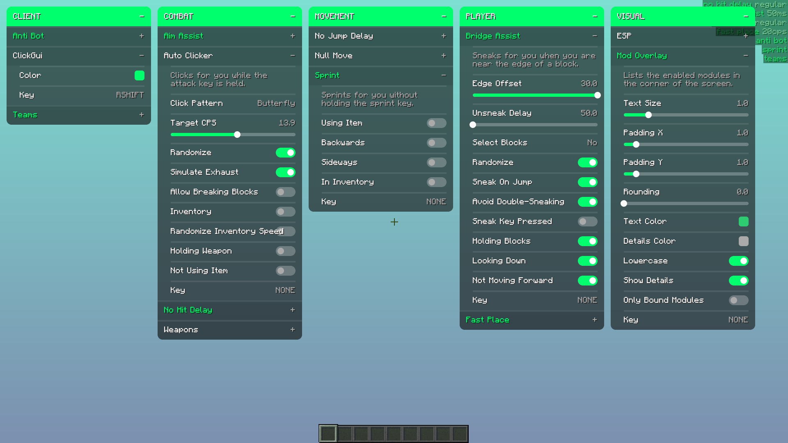

# Illusion [W.I.P]

An independent, fully open source ghost client for Minecraft 1.8.9, written from the ground up. [Join the Discord!](https://discord.com/invite/rzgm3C8YWu)

---

## Building

Requires Git and Java 25.

```sh
git clone https://codeberg.org/awruff/Illusion.git
cd Illusion
./gradlew build
```

The jar is written to `build/libs/`.

## Screenshot



---
